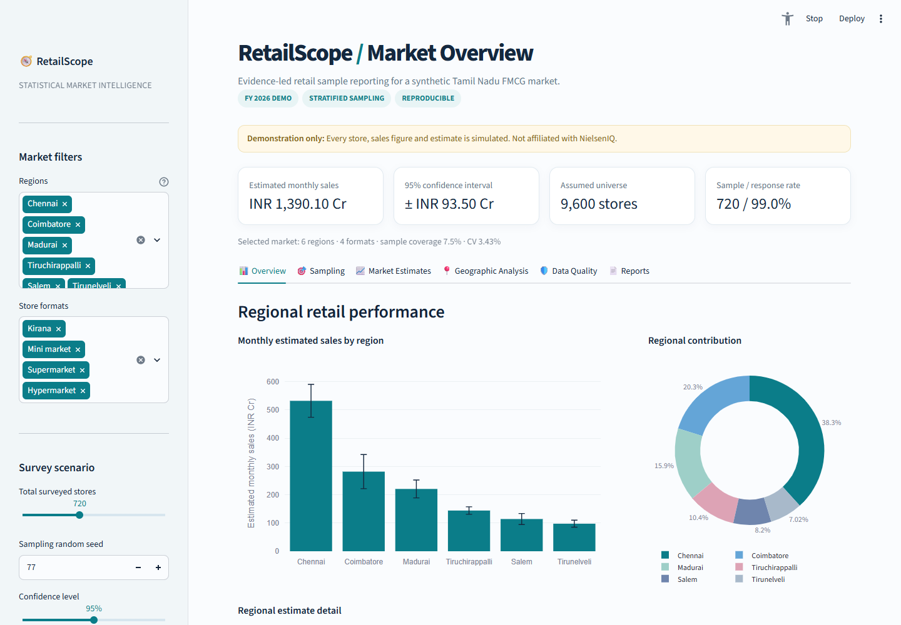

# RetailScope | Synthetic retail market intelligence

RetailScope is a Streamlit portfolio dashboard for retail survey design, market sales estimation, store-universe estimation, quality review, and stakeholder reporting. It was built as an independent demonstration relevant to a data science role in product design and enhancement.

**Every store, sales value, list, and market result is synthetic.** The named cities are labels in a fictional scenario. Nothing here is real Tamil Nadu retail data, a NielsenIQ output, or an NIQ proprietary method. RetailScope is not affiliated with or endorsed by NielsenIQ.



The downloadable report is also [previewed on page 1](docs/report-page1.png) and [page 2](docs/report-page2.png).

## Run locally

Tested with Python 3.11 on Windows. Install Python 3.11+ and run from this folder:

```powershell
python -m venv .venv
.venv\Scripts\python.exe -m pip install -r requirements.txt
.venv\Scripts\python.exe -m streamlit run app.py
```

Open **http://localhost:8501**. `run_windows.bat` also creates the environment and launches the app. On macOS/Linux, use `python3 -m venv .venv` and `.venv/bin/python` for the remaining commands.

## What is in the dashboard

| View | Purpose |
| --- | --- |
| Overview | Monthly sales KPIs, confidence interval, regional contribution, and ranked regional estimates |
| Sampling | Frame and sample composition, stratum allocation, proportional versus Neyman designer, and repeated-sample simulation |
| Market Estimates | Weighted sales expansion, regional precision, and a separate two-list synthetic store-universe estimation lab |
| Geographic Analysis | Approximate city markers sized by estimated sales and a regional precision table |
| Data Quality | Missing sales, duplicate IDs, invalid values, advisory outliers, response rates, and regional coverage review |
| Reports | Downloadable stakeholder PDF, regional CSV, survey CSV, synthetic-truth diagnostic, and methodology |

Filters select regions and store formats. Controls change sample size, random seed, confidence level, allocation size, simulation repetitions, and list inclusion probabilities. Plotly charts support hover and zoom. The six views are Streamlit tabs and share the same selected market.

## Statistical methodology

### Synthetic universe and sample

`retailscope/data.py` creates a seeded population of 9,600 fictional stores by default. Region and store-format frequencies are stylized assumptions; monthly sales have a right-skewed log-normal distribution. The app draws a without-replacement sample independently within each region × store-format stratum. Proportional allocation uses a minimum of three selected stores per nonempty stratum. Approximately 2.5% of sales responses are omitted independently in the default scenario.

### Weighted market sales and uncertainty

The sales calculation **assumes each stratum's store count is known** from the complete synthetic frame. For stratum `h`, it uses responding-store mean sales `ȳ_h`, known store count `N_h`, and respondent count `r_h`:

```text
Estimated monthly sales T̂ = Σ_h N_h × ȳ_h
Estimated sampling variance V̂ = Σ_h N_h² × (1 − r_h/N_h) × s_h²/r_h
```

The second expression uses the finite population correction and respondent sample variance `s_h²`. The app shows a two-sided normal approximation interval `T̂ ± z × √V̂` at the selected 90%, 95%, or 99% level. It withholds a total and interval when any stratum has no responses; it withholds the interval when a non-census stratum has fewer than two. The response adjustment treats respondents as a random subset within each stratum. That assumption can fail in real fieldwork.

The app rejects duplicate sample IDs, IDs absent from the frame, mismatched strata, negative or nonfinite observed sales. Robust log-sales deviations within store format flag possible outliers for review; flags do not remove observations. The quality view uses illustrative 5% sample-fraction and 90% response-rate review thresholds, which are not universal standards.

### Sample designer and simulation

The designer compares one overall simple random sample, proportional stratification, and Neyman allocation. Neyman allocates approximately in proportion to `N_h × S_h`, with integer caps and a two-store minimum. Here `S_h` is calculated from the *known synthetic population*. An actual study would need pilot or historical stratum variance estimates. The repeated-sample experiment draws all three designs with a common sample size and full response, then calculates signed bias, RMSE, mean interval width, and empirical interval coverage against synthetic truth. Simulation results depend on the seed and repetition count; they do not validate real-world coverage.

### Store-universe estimation lab

The separate lab generates two independent synthetic lists from the selected known population and uses the Chapman point estimate `((A+1)(B+1)/(overlap+1))−1`. It withholds the estimate when fewer than two stores overlap. This exercise assumes a closed universe, independent lists, equal inclusion chances, correct matches, and no duplicate or false records. The known synthetic count is shown for validation. **The two-list estimate is not used as the sales expansion weight**, and its uncertainty is not included in the sales interval. See the [UN census evaluation guide](https://unstats.un.org/unsd/demographic/meetings/wshops/Jordan_21Nov10/Manuals/USA_Evaluating_Censuses.pdf) and [capture–recapture lecture notes](https://www.stat.cmu.edu/NCRN/PUBLIC/RLClassFiles/Lectures/CaptureRecaptureLohr.pdf) for background on the model and its assumptions.

## Exports and reproducibility

The Reports view exports a two-page stakeholder PDF and two CSV files for the active filters. The PDF states the synthetic provenance and the method limits; every CSV row includes a provenance field. Recreate the checked-in default examples with:

```powershell
.venv\Scripts\python.exe scripts\generate_sample_outputs.py
.venv\Scripts\python.exe generate_preview.py
```

The HTML preview in `sample_outputs/` is a static overview snapshot with interactive chart hover. Use the Streamlit app for filters, simulations, and live downloads.

## Validation

```powershell
.venv\Scripts\python.exe -m pytest -q
.venv\Scripts\python.exe scripts\smoke_dashboard.py
```

The pytest suite checks deterministic generation, allocation constraints, full-census totals and zero variance, regional additivity, finite population correction behavior, missing and invalid data, two-list edge cases, simulation reproducibility, CSV provenance, and PDF bytes. The Streamlit smoke script renders all six tabs, applies filters, and runs the design simulation. It uses Streamlit's AppTest harness and may require local socket permission in a restricted environment. To refresh the screenshot, run the app and then `python scripts/capture_screenshot.py` with Playwright and Chrome installed.

With the app running, `python scripts/browser_smoke.py` checks each tab and downloads the PDF and both CSVs. This optional browser check also requires Playwright and Chrome.

## Architecture

```text
app.py                         Streamlit controls, views, and Plotly charts
retailscope/data.py            Seeded synthetic frame and stratified draw
retailscope/stats.py           Sales totals, intervals, regional summaries, quality
retailscope/design.py          Proportional/Neyman allocation and simulation
retailscope/universe.py        Illustrative two-list store-count estimate
retailscope/reporting.py       PDF and provenance-labeled CSV exports
tests/                        Unit and reporting tests
scripts/                      Smoke check, sample export, screenshot helper
sample_outputs/               Default synthetic example downloads
docs/dashboard-overview.png    Screenshot of the running app
```

## Limits and interview discussion

The synthetic frame is complete by construction. Real retail universe estimation must address list dependence, heterogeneous capture, incomplete coverage, matching errors, and domain definitions. Sales intervals here cover only modeled sampling variation under the response assumption; they exclude uncertainty in universe size, nonresponse bias, measurement error, clustering, and time trends. Approximate normal intervals may have poor coverage for sparse or highly skewed domains. Do not interpret these demo results as actual market projections.
